# Polyphonia · 汇声 —— Folia 自定义音源壳插件（六平台聚合 / 榜单 / 歌单 / 链接导入）

Polyphonia（汇声）是为 Folia 打造的自定义音源壳插件：导入一个 LX Music 格式的自定义源脚本，即以一个入口聚合多平台的搜索、榜单、歌单与播放。插件本体不含任何音源，播放链接全部由你自己导入的脚本解析。

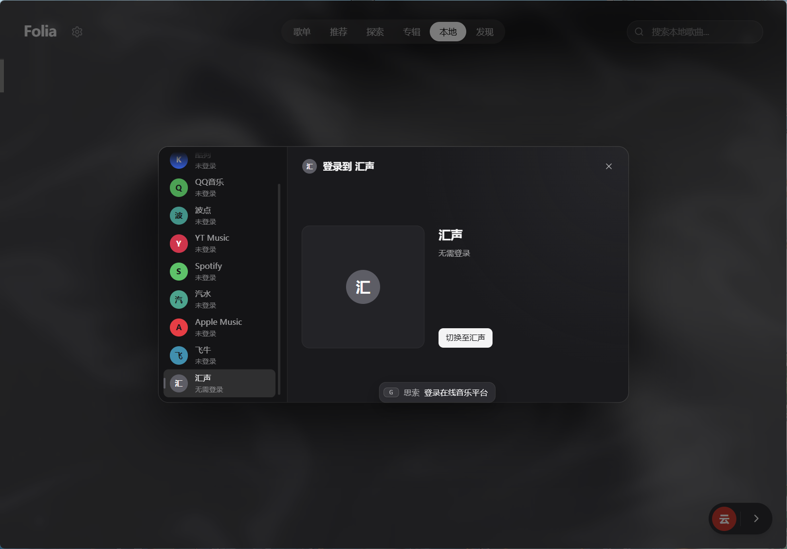

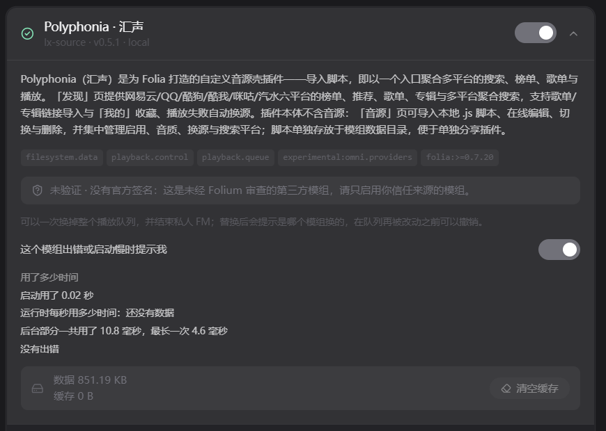

当前版本：1.0.0　|　要求：Folia ≥ 0.7.20（Folium 1.7+），已开启模组系统

## 功能

- **发现页**：网易云 / QQ / 酷狗 / 酷我 / 咪咕 / 汽水六平台的榜单、推荐、歌单、专辑，一键切换平台。

  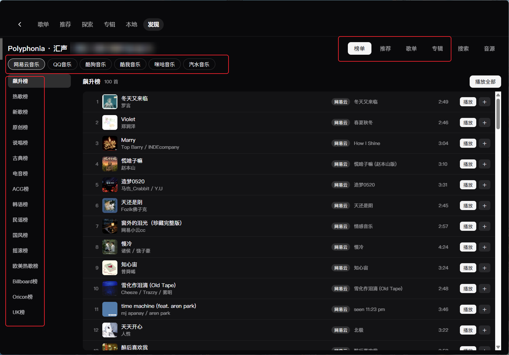

  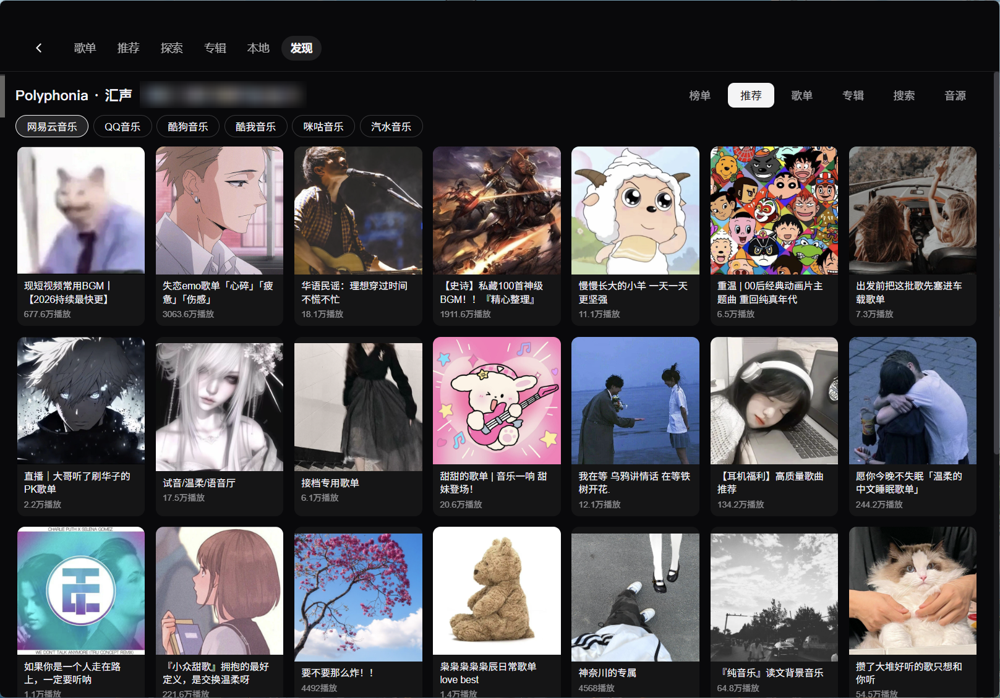

  

  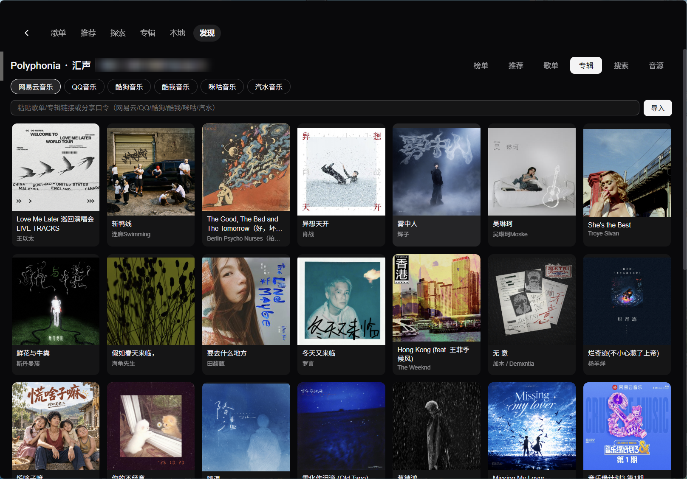

- **聚合搜索**：多平台同时搜索、合并结果；可按平台、歌手筛选；支持「歌名 歌手」组合关键词（如「演员 薛之谦」）提高准确度。

  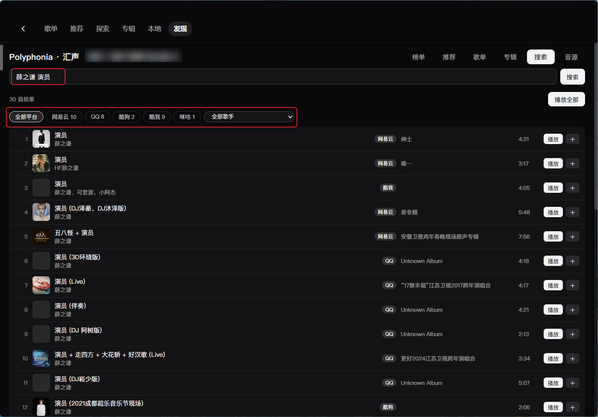

- **链接导入与收藏**：粘贴歌单 / 专辑分享链接解析播放，自动收藏到「歌单 → 我的」；收藏持久保存，随时进入整单播放。

  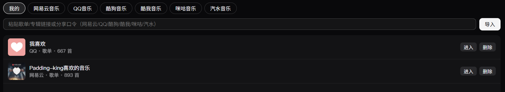

- **播放联动**：单曲播放、加入队列、播放全部；播放失败自动在其他已启用平台搜索同名歌曲重试（可关闭）。

- **音源管理**：导入本地 .js 脚本、在线编辑（保存自动重载）、切换、删除。脚本单独存放于模组数据目录，插件可以不带源单独分享。

- 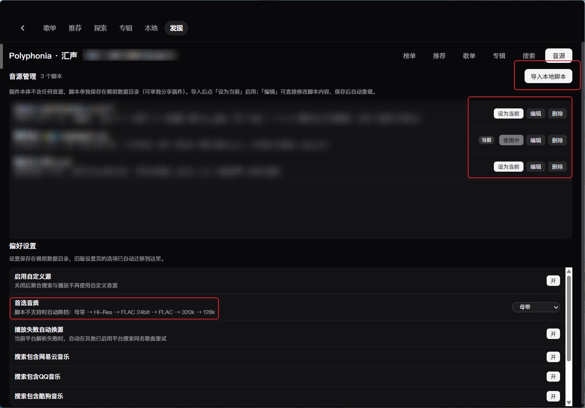

- **偏好设置**：与脚本管理同页（「音源」页下方），集中管理启用、首选音质（母带 → Hi-Res → FLAC 24bit → FLAC → 320k → 128k 自动降档）、自动换源、六平台搜索开关。

- **歌词**：复用 Folia 宿主接口，桌面歌词与播放页特效正常。

---

## 新增功能（1.0.0）

- **「我的」升级为顶层页签**：位于榜单前（取代旧版「歌单 → 我的」子页签，上文相关截图为旧布局），汇总导入的歌单 / 专辑、合并结果、本地歌单与「我喜欢」。支持新建歌单、重命名、删除、将歌曲移出列表、多单合并去重；每行「导出」生成 JSON 备份（含完整歌曲信息，存放于模组数据目录 exports 文件夹）。

  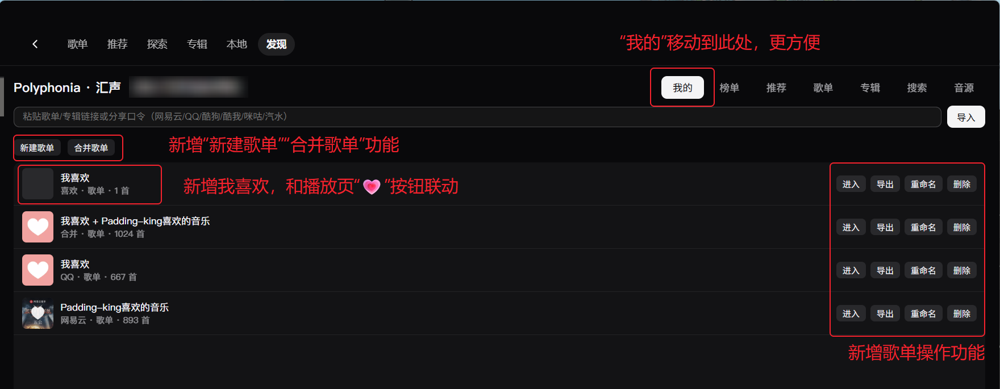

  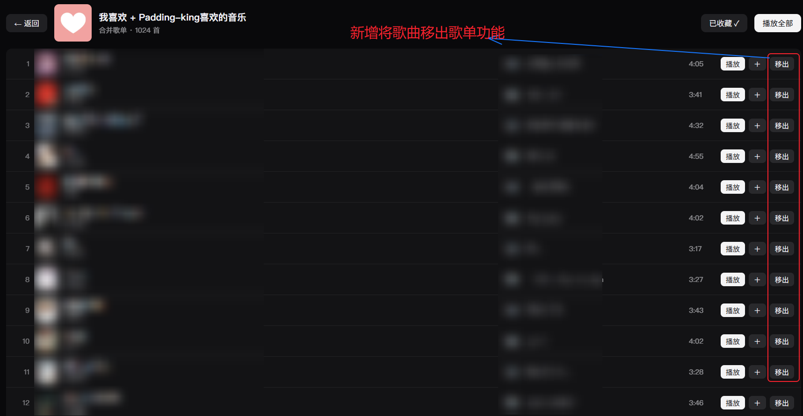

- **播放页收藏**：进度条右侧新增喜欢与收藏按钮，控制条收起时自动隐藏、展开时恢复，字体颜色动效与原生一致。喜欢即加入 / 移出「我喜欢」；收藏打开播放器面板「汇声收藏」标签页，可把当前播放曲送入我喜欢或任意我的歌单，也可新建歌单并收藏。

  

  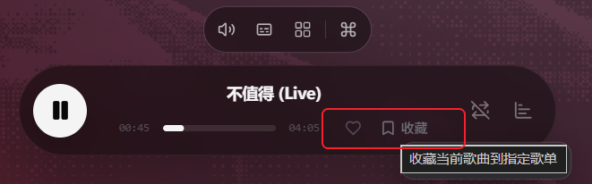

  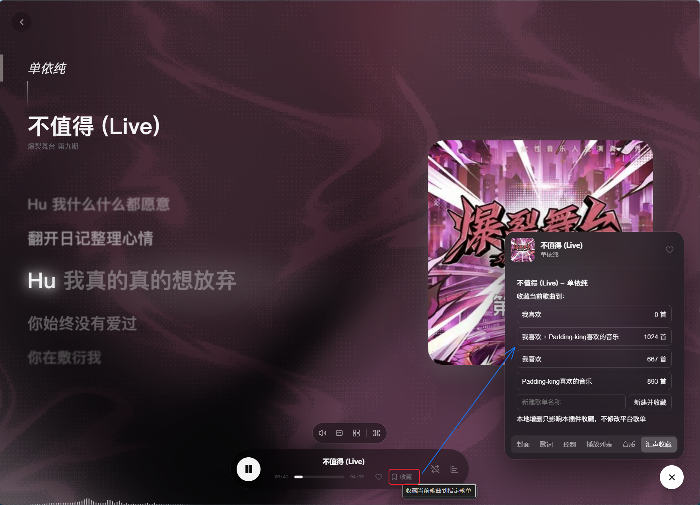

### 收藏与喜欢的作用域

- 「我喜欢」与全部收藏列表（含导入歌单上的增删）只保存在本插件的本地数据目录，仅在本插件内生效。
- 不写回平台歌单，不同步 Folia 宿主的喜欢按钮或平台账号的红心；宿主喜欢与插件我喜欢互不影响。
- 在「我的」里对平台歌单移出 / 添加歌曲是插件本地覆盖，平台原歌单不变；导出文件反映增删后的实际列表。

### 新增用法

1. 播放页：进度条右侧心形按钮把当前歌曲加入 / 移出「我喜欢」；「收藏」打开播放器面板「汇声收藏」标签页，选择目标歌单或新建并收藏。
2. 「我的」：新建歌单、重命名、删除、移出歌曲；行内「导出」生成 JSON 备份。

## 它不是什么

- 不含任何源脚本、播放链接或音频内容。未导入脚本时可以浏览榜单 / 歌单和搜索，但无法播放。
- 不破解、不绕过任何平台限制；脚本能否解析出链接、解析出什么音质，完全取决于脚本本身。

## 安装

1. 从 GitHub Releases 下载 `polyphonia-1.0.0.zip`。
2. Folia 设置 → 模组页：把 zip 直接拖进页面即可安装；或手动解压，将包内 `polyphonia` 文件夹放入 mods 目录：
   - Windows：`%APPDATA%\Folia\mods\polyphonia`
   - macOS：`~/Library/Application Support/Folia/mods/polyphonia`
3. 重载模组（或重启 Folia），首次启用会弹出授权确认，确认即可。以后更新版本需重新确认授权。

## 使用

1. 首页「发现」页签 → 「音源」页 → 「导入本地脚本」，选择你的 LX Music 格式 .js 脚本，点「设为当前」启用。
2. 「音源」页下方「偏好设置」选择首选音质，按需开关自动换源和各搜索平台；切换脚本用列表中的「设为当前」。
3. 榜单 / 推荐 / 歌单 / 专辑里点歌曲即播放；歌单页顶部输入框粘贴分享链接可导入歌单 / 专辑。
4. 脚本更新：在「音源」页「编辑」后保存（自动重载），或删除后重新导入。

## 已知限制

- 部分平台的专辑 / 推荐接口暂缺（如酷我 / 咪咕 / 汽水的专辑），页面会明确提示暂不支持。
- 榜单 / 歌单数据来自各平台公开接口，接口调整或风控可能导致暂时加载失败，重试或切换平台通常可恢复。
- 播放可用性与音质取决于导入的脚本，插件只负责接入与降档。

## 免责声明

1. 本插件为通用技术壳：不含、不存储、不分发任何音源、播放链接或音频内容，也不提供任何源脚本。
2. 源脚本由第三方提供、用户自行导入。作者不对脚本内容的合法性、准确性、可用性作任何保证，亦不对使用脚本产生的任何后果承担责任。
3. 本插件及本说明仅供个人学习、研究和技术交流使用，不得用于商业用途或任何形式的侵权传播。
4. 使用者应遵守著作权法律法规及各平台服务条款，尊重版权方权益；如权利人提出异议，应立即停止使用并删除相关脚本与内容。
5. 使用本插件的风险由使用者自行承担，作者不对因使用或无法使用本插件造成的任何直接或间接损失负责。

使用中遇到问题欢迎提 Issue 反馈，请附 Folia 版本、脚本名称与复现步骤。